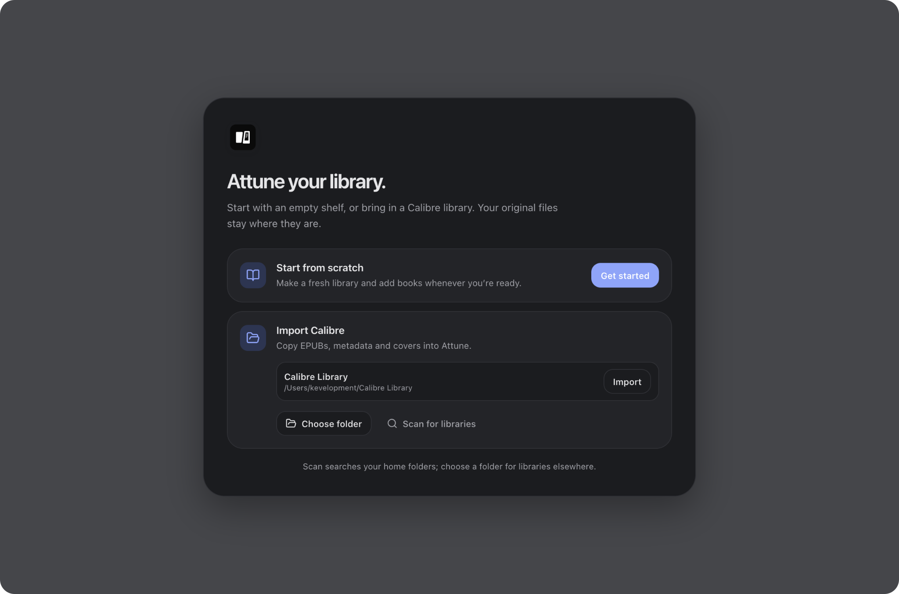
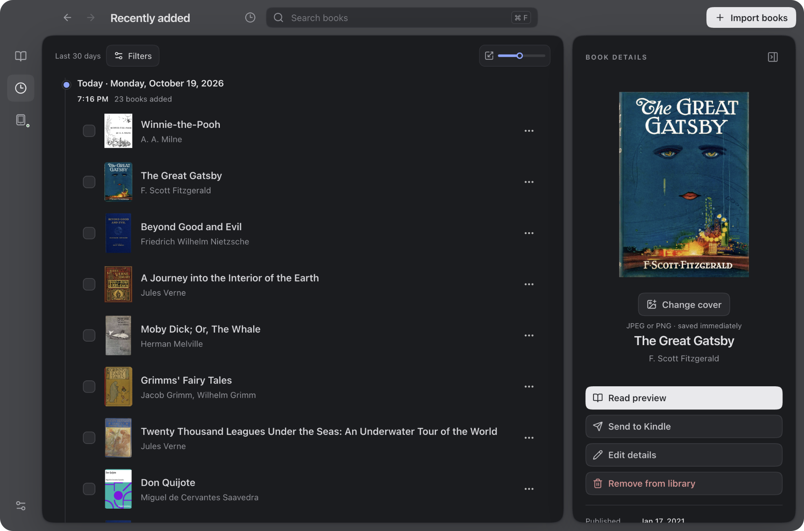
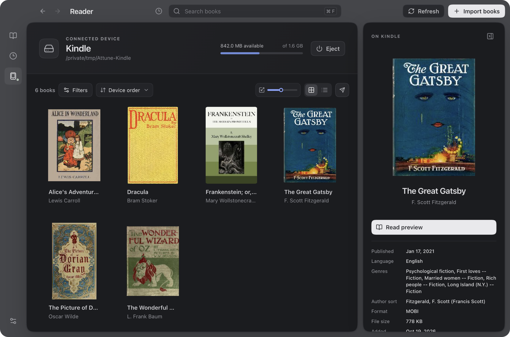

  <picture>
    <source media="(prefers-color-scheme: dark)" srcset="frontend/public/attune-dark.svg">
    
  </picture>

<h1 align="center">Attune</h1>

<strong>Attune your library.</strong> A modern, open-source ebook manager and lightweight Calibre alternative.

  
  
  

  <a href="https://github.com/kevelopment/Attune/releases/latest">Download latest release</a> ·
  <a href="#a-little-less-library-admin">Features</a> ·
  <a href="#bring-your-calibre-library">Import from Calibre</a> ·
  <a href="docs/development.md">Build from source</a> ·
  <a href="docs/releasing.md">Release guide</a>

  

Four views of one local library, including a simulated Kindle.

View individual screenshots

<table>
  <tr>
    <td width="50%"> Welcome</td>
    <td width="50%"> Library</td>
  </tr>
  <tr>
    <td width="50%"> Recently added</td>
    <td width="50%"> Simulated Kindle</td>
  </tr>
</table>

## A little less library admin

A local home for your books: organize files and metadata, read common ebook formats, and send compatible files to reader storage over USB or MTP. Your original Calibre library stays untouched. No account or Calibre installation required.

### Bring your Calibre library

Start fresh or import books, metadata, and covers from an existing Calibre library. Attune copies format files into its own library and leaves Calibre’s library untouched. [Import details](docs/calibre-import.md).

### A companion for your reader

Browse and manage mounted USB storage or MTP readers with reader-family profiles, including Kindle, Kobo, PocketBook, Tolino, NOOK, BOOX/Onyx, and Supernote. Unknown storage can be configured with per-device folders and formats. Profiles are conservative transfer defaults, not hardware certification; compatibility still needs testing on real devices.

## Download

Download Attune for your operating system and CPU from the [Releases page](https://github.com/kevelopment/Attune/releases). Packages include the conversion helper; no developer tools or Calibre installation are required.

| Platform | Package |
| --- | --- |
| macOS 13+ | DMG installer and updater ZIP |
| Windows | ZIP archive |
| Linux | RPM or DEB installer, plus a compressed application archive |

**macOS installation:**

1. For a DMG, open it and drag Attune to Applications. For a ZIP, extract it and move `Attune.app` into Applications.
2. If Gatekeeper says “Apple could not verify Attune,” choose **Done**, then open **System Settings → Privacy & Security** and select **Open Anyway** for Attune.
3. Choose **Open** in the confirmation prompt. See [Apple’s instructions](https://support.apple.com/en-us/102445) for details. Current macOS downloads are ad-hoc signed and not Apple-notarized, so this may be needed on first launch.

Windows downloads are not Authenticode-signed. Linux packages include an application launcher and ask the system package manager to install GTK 3, WebKit2GTK 4.1, libmtp, and C runtime dependencies during installation. Fedora Asahi users should choose the ARM64 RPM. The Linux app uses system GTK/WebKit libraries, so the native packages resolve those runtime dependencies instead of bundling them into the Go executable. Windows requires WebView2. See the [release guide](docs/releasing.md) for installation and device requirements.

## Software updates

Attune checks for updates on startup and every 15 minutes. When a new release is available, use the sidebar download icon to install it and restart when ready. Your library stays in place.

## Build from source

Attune uses **Go · Wails v3 · React · TypeScript · SQLite**. It uses the operating system's webview rather than shipping a separate browser engine. [Kindling](https://github.com/ciscoriordan/kindling) provides standalone EPUB-to-MOBI conversion.

Use `mise run dev` for a browser preview, `mise run test` for Go tests, and `mise run lint` for formatting, vet, and TypeScript checks. On macOS, `mise run up` starts the native app with React/CSS hot reload and Go rebuilds; `mise run down` stops it. `mise run build` builds the desktop app for the current platform. See [development setup](docs/development.md) for prerequisites and platform details.

See [releasing](docs/releasing.md) for the tag-driven build and publication workflow.

## Where things stand

Attune is an early-stage project. Built-in reading supports DRM-free EPUB, MOBI/AZW3, FB2, TXT, PDF, CBZ, and CBR. Mounted USB and MTP transports are implemented, but broad model and firmware verification remains ongoing. Calibre positions, bookmarks, highlights, and notes are imported; items Attune cannot place are retained as unresolved annotations.

Cloud sync is not planned. Attune is designed to work locally without requiring an account.

For current capabilities and limits, see the [capability matrix](docs/capability-matrix.md) and [Calibre import guide](docs/calibre-import.md).

## Contributing

All contributions are welcome. Small, focused changes are easier to review. Pull requests automatically run the required test and lint checks.

## License & acknowledgements

Attune takes inspiration from [Calibre](https://github.com/kovidgoyal/calibre), created by Kovid Goyal. Thank you to Kovid and the Calibre community for building the foundation that so many ebook tools and readers rely on.

[MIT](LICENSE), with separate [third-party notices](docs/third-party-notices.md). Thanks to [Wails](https://wails.io), [Kindling](https://github.com/ciscoriordan/kindling), and the open-source ebook community. The name is a small nod to resting and preparing for the next journey at a bonfire.
