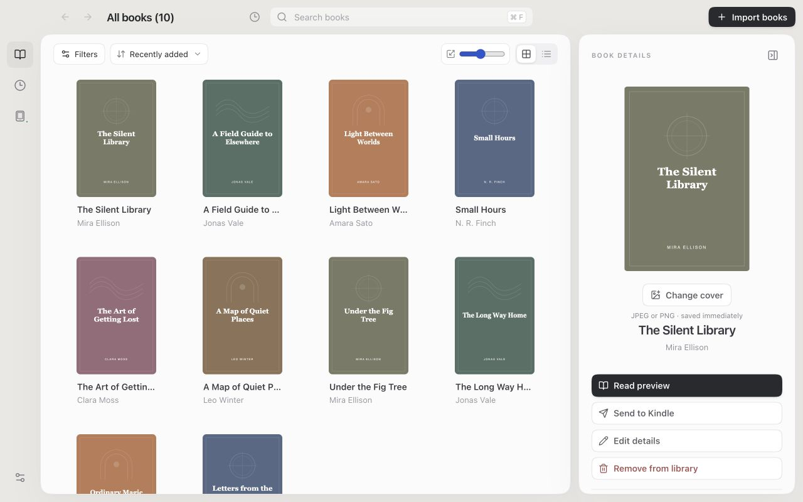
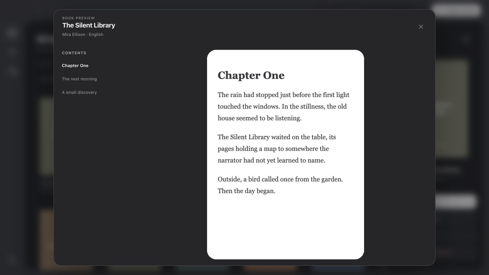

<p align="center">
  
</p>

<h1 align="center">Attune</h1>
<p align="center"><strong>Attune your library.</strong><br>A quiet home for your ebooks, and a companion for your reader.</p>

<p align="center">
  <a href="LICENSE"></a>
  
  <a href="https://wails.io"></a>
</p>

<p align="center">
  <a href="#download">Download</a> ·
  <a href="#a-little-less-library-admin">Features</a> ·
  <a href="docs/development.md">Build from source</a> ·
  <a href="docs/releasing.md">Release guide</a>
</p>

<p align="center">
  
  <br><sub>Staged preview with fictional books, authors, and original cover artwork. No personal library data.</sub>
</p>

## A little less library admin

Keep your EPUBs together, tidy their details, and send a few good books to your reader. Attune manages the library locally and handles Kindle conversion with a bundled helper—no Calibre installation or cloud account required.

| Make room for your books | Take a closer look |
| --- | --- |
| Import DRM-free EPUBs by dropping files or using the picker. Follow batch progress and skip exact duplicates. | Browse a cover grid or compact list. Search, sort, and filter by author, genre, or language. |
| Correct titles, authors, publisher, dates, genres, series, and descriptions in a resizable details panel. | Preview chapters, local book styling, and images in a centered reading page. |
| Keep original EPUBs intact in an app-managed library. | Choose book actions from the three-dot menu or select several books at once. |

### A small pause before the next chapter

<p align="center">
  
</p>

The preview is a quick way to check a book's contents and language before sending it. Scripts and remote content are blocked. It is not a simulation of a particular e-reader.

### A companion for your reader

On macOS, connect a mounted USB Kindle to browse its books and available space, send books with automatic legacy MOBI conversion, remove device copies, or eject safely. Transfers verify copied bytes, refuse to overwrite existing files, and skip unchanged verified copies.

The initial device target is **original Kindle 1 and 2**. Support for more readers—including Tolino and Kobo—is planned. Device support and operating-system support are separate: Windows and Linux builds currently offer the library and preview; USB management is macOS-only.

## Download

Open this repository's **Releases** page and choose the archive for your operating system and CPU. Release archives include the conversion helper and its license; you do not need Go, Node.js, Rust, or Calibre to run Attune.

| Platform | Status | Package |
| --- | --- | --- |
| macOS 13+ | Primary platform; library and USB Kindle management | App bundle in a ZIP archive |
| Windows | Experimental; library and preview | ZIP archive |
| Linux | Experimental; library and preview | Compressed application archive |

Windows and Linux runtime validation is still limited. macOS downloads are locally signed, not Apple-notarized; Windows downloads are not Authenticode-signed. See the [release guide](docs/releasing.md) for packaging, system requirements, and signing status.

## Build from source

Attune uses **Go · Wails v2 · React · TypeScript · SQLite**. It uses the operating system's webview rather than shipping a separate browser engine. [Kindling](https://github.com/ciscoriordan/kindling) provides standalone EPUB-to-MOBI conversion.

For development, use `mise run up` to start the native app with React/CSS hot reload and Go rebuilds; `mise run down` stops it. The development library is isolated from your normal library. See [development setup](docs/development.md) for prerequisites.

For a local macOS build:

```sh
./scripts/fetch-kindling.sh
./scripts/build.sh
open build/bin/Attune.app
```

See [development](docs/development.md) for prerequisites, tests, browser preview, and the project layout. See [releasing](docs/releasing.md) for the tag-driven build and publication workflow.

## Where things stand

Attune is an early project. The library, metadata editor, book preview, and macOS USB transfer flow are implemented. A full reader with annotations and reading progress, PDF import, and additional device families are future work.

Cloud sync is not planned. Attune is designed to work locally without requiring an account.

Metadata edits are stored in the library without changing the original EPUB. Generated Kindle files currently receive title and author overrides; other edited fields remain library metadata.

## Contributing

Bug reports, small fixes, and device compatibility reports are welcome. For larger changes, describe the problem and proposed behavior in an issue first. Keep changes focused and run the [local checks](docs/development.md#checks).

## License & acknowledgements

[MIT](LICENSE), with separate [third-party notices](THIRD_PARTY_NOTICES.md). Thanks to [Wails](https://wails.io), [Kindling](https://github.com/ciscoriordan/kindling), and the open-source ebook community. The name is a small nod to resting and preparing for the next journey at a bonfire.
